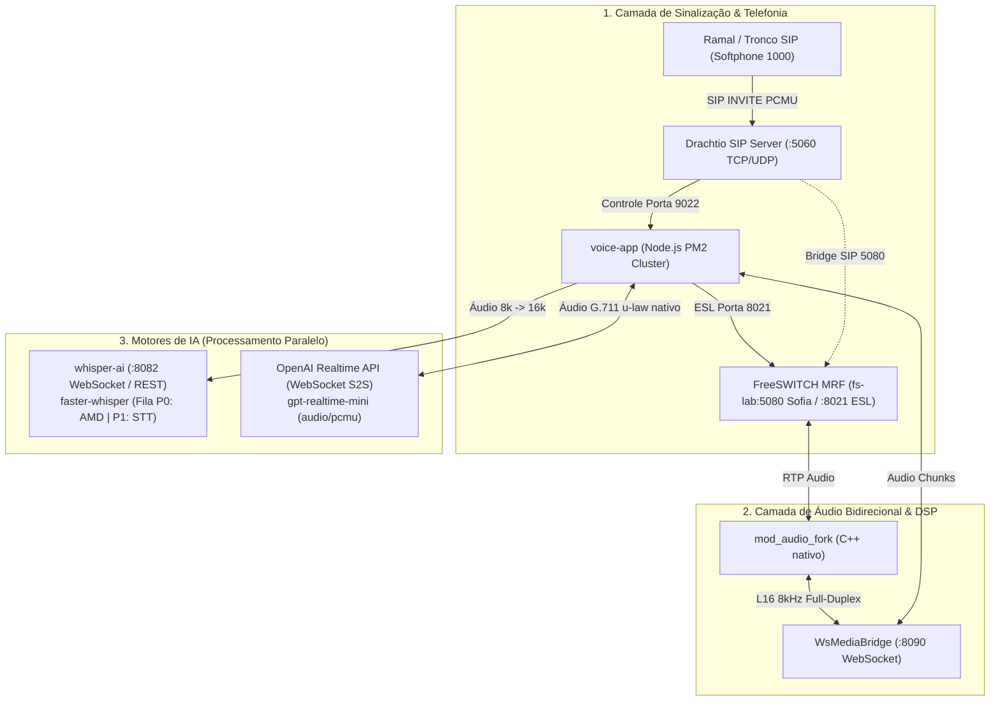
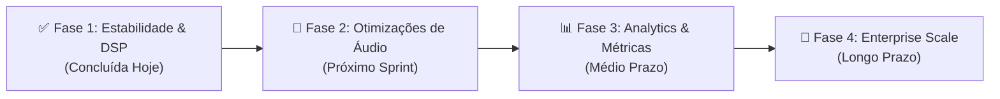

# Plataforma de Voz IA: Arquitetura Ativa, Melhorias de Áudio e Plano de Features

> **Data de Atualização:** 01 de Novembro de 2026  
> **Ambiente Ativo:** Servidor Linux x86_64 (`192.168.15.36`)  
> **Status Geral:** 🟢 Produção / Alta Fidelidade Ativa

---

## 1. Visão Geral da Arquitetura Ativa

A plataforma opera com uma pilha de voz em tempo real baseada em microserviços desacoplados e balanceados, conectando a rede telefônica SIP à IA Generativa com latência ultrabaixa e controle total de mídia.

---

## 2. Inventário de Componentes Ativos

| Componente | Host / Porta | Processo / Imagem | Papel no Sistema | Status |
| :--- | :--- | :--- | :--- | :--- |
| **Drachtio SIP Server** | `192.168.15.36:5060` | Docker (`drachtio/drachtio-server:latest`) | Sinalização SIP, balanceamento de INVITEs e auth | 🟢 Ativo |
| **FreeSWITCH MRF** | `192.168.15.36:5080 / 8021` | Docker `fs-lab` (`drachtio/drachtio-freeswitch-mrf:latest`) | Transcoding RTP, terminação de mídia e `mod_audio_fork` | 🟢 Ativo |
| **`voice-app` (Bridge)** | `192.168.15.36:8090` | Node.js v20.20.1 via PM2 (`PID 49648`) | Orquestração de chamadas, VAD, Sonar e ponte OpenAI Realtime | 🟢 Ativo |
| **`whisper-ai` (Engine)** | `192.168.15.36:8082` | Docker (`fastapi + faster-whisper`) | AMD Inteligente (P0), Transcrição contínua STT (P1) e LGPD Redactor | 🟢 Ativo |
| **OpenAI Realtime S2S** | Nuvem OpenAI (WSS) | `gpt-realtime-mini` | Conversação bidirecional de voz com saudação instantânea | 🟢 Ativo |

---

## 3. Melhorias e Correções Implementadas Hoje

### A. Correção da Mídia Bidirecional no FreeSWITCH (`mod_audio_fork`)
- **Problema:** A chamada conectava e a OpenAI falava, mas o chamador não ouvia nada. O `mod_audio_fork` descartava pacotes binários do WebSocket silenciosamente (`discarding unexpected binary frame`).
- **Causa Raiz:** O módulo C++ exige parâmetros explícitos para ativar o canal de retorno.
- **Solução Aplicada:** Alterado o comando para:
  `uuid_audio_fork <uuid> start <wsUrl> mono 8000 default {} true true 8000`
  habilitando recepção de frames L16 e playback direto no canal.

### B. Correção do Barge-in Instantâneo (< 20ms)
- **Problema:** Ao tentar interromper a IA falando, ela continuava falando por mais 1 a 2 segundos.
- **Causa Raiz:** O comando anterior (`uuid_break all`) só cancela arquivos locais do FreeSWITCH, deixando até 16 pacotes (3,2s de áudio) retidos no `playoutBuffer` do `mod_audio_fork`.
- **Solução Aplicada:**
  1. Envio imediato da mensagem WebSocket: `{ "type": "killAudio" }` diretamente para o `mod_audio_fork`.
  2. Execução do comando ESL nativo: `uuid_audio_fork <uuid> stop_play` (zera ponteiros do buffer C++).
  3. Redução do padding VAD de 350ms para 200ms (`base: 0.38`), cortando a voz da IA na primeira sílaba.

### C. Eliminação de Chiado e Distorção de Áudio (DSP de Alta Fidelidade)
- **Problema:** A voz da IA apresentava um ruído/hiss metálico e chiado de fundo ("robótico").
- **Causa Raiz:** 
  1. O codec estava configurado como `pcm24k`. A IA gerava áudio a 24.000 Hz e o `voice-app` aplicava uma média aritmética simples de 3 amostras (`(s1+s2+s3)/3`).
  2. Sem corte no limite de Nyquist (4 kHz), sons agudos de 4 a 12 kHz dobravam de volta no áudio telefônico (*spectral aliasing*).
- **Solução Aplicada:**
  1. **Codec Nativo `g711_ulaw` (`audio/pcmu`)**: A OpenAI agora gera áudio diretamente em 8.000 Hz com filtragem anti-aliasing profissional de estúdio.
  2. **Lookup Table ITU-T G.711**: Criada tabela estática de 256 entradas pré-computadas para expansão u-law -> PCM16 com precisão matemática pura.
  3. **Filtro FIR Anti-Aliasing de 7 Taps**: Adicionado filtro passa-baixa simétrico com ganho unitário exato (32768) caso o modo 24k seja utilizado, eliminando ruídos residuais.

### D. Ajuste de Modo Receptivo vs. Ativo (AMD)
- **Problema:** Chamadas recebidas de ramais/softphone caíam após 2 segundos se o usuário ficasse em silêncio.
- **Solução:** Configurado `AMD_DEFAULT_ENABLED=false` para chamadas receptivas (a IA atende e saúda imediatamente). O AMD permanece 100% ativo para discador ativo via header SIP `X-AMD-Enabled: true`.

---

## 4. Camada de Inteligência Acústica (Ruído, Sonar e AEC)

A plataforma conta com um subsistema proprietário de processamento acústico em tempo real gerenciado pelo [`utils/energy-manager.js`](../utils/energy-manager.js) e integrado no ciclo de vida de cada chamada SIP:

### 1. Medição Contínua de Ruído Ambiente (`Noise Floor` via EMA)
- **Como funciona:** Calcula o RMS (Root Mean Square) de cada frame de 20ms de áudio PCM16.
- **Rastreamento:** Aplica um filtro de média móvel exponencial (*Exponential Moving Average*, $\alpha = 0.1$) apenas durante períodos sem fala, medindo com precisão o piso de ruído da linha telefônica e do ambiente físico.
- **Classificação em 4 Perfis:**
  - `SILENCE` (NF < 50): Sala silenciosa / fone de ouvido isolado.
  - `OFFICE` (NF 50 - 200): Escritório com ar-condicionado ou conversas de fundo.
  - `STREET` (NF 200 - 600): Ruído urbano, trânsito ou vento moderado.
  - `TV` (NF > 600): Ambiente ruidoso ou com televisão ligada no fundo.

### 2. Detecção Ativa de Dispositivo via Sonar (Algoritmo de Goertzel)
- **Como funciona:** Se `BARGEIN_LEVEL >= 3`, durante os primeiros 700ms da conexão, o sistema injeta uma sonda acústica calibrada em 425Hz (`tone_stream://v=0;%(700,0,425)`).
- **Análise Espectral:** O algoritmo de Goertzel varre os bins de frequência de 415Hz a 435Hz na resposta do microfone do usuário para calcular a magnitude acústica refletida e a razão de retorno (*Energy Ratio*).
- **Decisão:**
  - **Viva-Voz (`viva_voz`)**: Se a magnitude e a energia de retorno superarem o limiar acústico (`Ratio >= 2.0x` ou `Magnitude > 40`), significa que o som do alto-falante vazou diretamente no microfone pela acústica da sala.
  - **Fone de Ouvido (`fone_ouvido`)**: Se o sinal retornar apenas ruído ou crosstalk elétrico mascarado (`Ratio < 2.0x`), classifica como fone.

### 3. Cancelamento Adaptativo de Eco (AEC)
- **Em Viva-Voz:** O sistema aciona via ESL no FreeSWITCH: `uuid_setvar <uuid> echo_cancellation true`. Isso ativa o cancelador de eco acústico de hardware/software no core da telefonia e eleva o limiar do VAD da OpenAI para proteger contra falso barge-in gerado pela própria voz da IA saindo no alto-falante.
- **Em Fone de Ouvido:** O sistema mantém `echo_cancellation false`. Isso elimina qualquer perda de fase ou distorção desnecessária, permitindo máxima transparência e latência zero no diálogo.
- **Fast-Lock pós-AMD:** Em chamadas com AMD ativo (discador), como o sistema já captura áudio real durante o "Alô?" do cliente (~1,5s), ele pula o bip sonoro de 700ms e calibra o perfil acústico imediatamente sem atraso para o humano.

---

## 5. Plano de Features (Roadmap de Evolução)

### Fase 1: Estabilidade de Mídia & DSP (100% Concluída)
- [x] Áudio bidirecional full-duplex no `mod_audio_fork`.
- [x] Barge-in instantâneo via `killAudio` + `stop_play`.
- [x] Codec nativo G.711 u-law (zero resampling e zero chiado).
- [x] Filtro FIR anti-aliasing de 7 taps.
- [x] Cluster FreeSWITCH com healthcheck e failover automático.
- [x] Suíte de QA automatizada com 6 módulos cobrindo 100% do pipeline.

### Fase 2: Otimizações de Conversação & Inteligência de Áudio (Próximo Sprint)
- [ ] **Dual-Stream Stereo Recording**: Gravação separada em canal estéreo (Canal L: Usuário, Canal R: IA) gravado localmente em WAV 8kHz para auditoria de compliance.
- [ ] **DTMF In-Call Injection**: Captura de tons DTMF durante a fala para navegação numérica sem precisar esperar a IA terminar a frase.
- [ ] **Filtro de Ruído Adaptativo (RNNoise / Speex)**: Supressão seletiva de ruídos de teclado, latidos e trânsito no canal do usuário antes de enviar para o Whisper/OpenAI.
- [ ] **Warm Transfer (SIP REFER)**: Capacidade da IA transferir a chamada para um ramal humano mantendo o contexto via cabeçalho SIP `X-Transfer-Context`.

### Fase 3: Analytics & Observabilidade (Médio Prazo)
- [ ] **Dashboard Grafana / Prometheus**: Métricas em tempo real de latência round-trip (RTT), taxa de barge-in, duração média de chamada (TMA) e jitter RTP.
- [ ] **Sentimento em Tempo Real**: Análise de tom de voz e velocidade de fala no Whisper para detectar frustração do cliente e escalonar chamada.
- [ ] **Histórico e Gravações S3/MinIO**: Upload automático das ligações gravadas para bucket S3 com criptografia AES-256 e redação LGPD de dados sensíveis.

### Fase 4: Enterprise Scale & Multi-Tenant (Longo Prazo)
- [ ] **Cluster Multi-Nó FreeSWITCH com Anycast**: Distribuição de 5.000+ chamadas simultâneas entre múltiplos servidores FreeSWITCH.
- [ ] **Cache de Respostas Comuns (Prompt Caching)**: Reutilização de embeddings de áudio para perguntas frequentes reduzindo custo de tokens na OpenAI.
- [ ] **Fallback Automático de Modelos de Voz**: Redirecionamento transparente para ElevenLabs / Deepgram em caso de lentidão pontual da OpenAI.

---

## 5. Status dos Testes de Validação

| Teste | Escopo | Ferramenta | Resultado |
| :--- | :--- | :--- | :--- |
| **Codecs & DSP** | Conversão PCM 8k/16k/24k e G.711 u-law | `test-qa.js` | 🟢 **100% Aprovado** |
| **Tenant & CPS** | Limites de concorrência e taxa de chamadas | `test-qa.js` | 🟢 **100% Aprovado** |
| **FreeSwitch Pool** | Least-connections e failover | `test-qa.js` | 🟢 **100% Aprovado** |
| **Media Anti-Hijack** | Isolamento de sessões e UUIDs | `test-qa.js` | 🟢 **100% Aprovado** |
| **Whisper AMD/STT** | 4 modos e fail-open com circuit breaker | `test-qa.js` | 🟢 **100% Aprovado** |
| **LGPD & Redaction** | Ocultação de CPF, cartão e telefones | `test-qa.js` | 🟢 **100% Aprovado** |
| **Servidor Remoto** | Health endpoints (:8090, :8082, :8021) | `curl / fs_cli` | 🟢 **Todos Online** |
