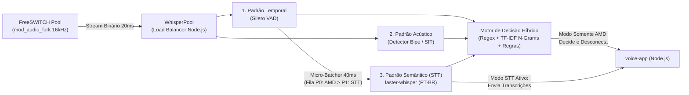

# Plano de Implantação: Detector Inteligente de Secretária (AMD + STT) Escalável no `voice-app`

> [!IMPORTANT]
> **Objetivo Central:** Substituir o AMD tradicional (baseado só em tempo de fala/silêncio) por um **Detector de Secretária Inteligente via STT (`faster-whisper`) + Identificação de Padrões**, operando de forma **100% independente e modular**: o cliente pode usar **Somente Detecção AMD**, **Somente Transcrição (STT)**, **Ambos** ou **Nenhum**.

---

## 1. Quatro Modos de Operação Independentes (Por Cliente ou Chamada)

As flags `amd.enabled` e `stt.enabled` no [`utils/tenant-manager.js`](../utils/tenant-manager.js) (ou headers SIP `X-AMD-Enabled` / `X-STT-Enabled`) são totalmente independentes:

| Modo Contratado pelo Cliente | Config no Tenant / Header SIP | Como o Sistema Opera na Chamada | Consumo do Whisper (GPU/CPU) |
| :--- | :---: | :--- | :--- |
| **1. Somente Detecção AMD**<br>*(Padrão Discador Ativo)* | `amd.enabled: true`<br>`stt.enabled: false` | Analisa **apenas os primeiros ~2,0s** na Fila P0, devolve a decisão (`humano`, `caixa_postal`, `operadora`, `silencio`) e **desconecta do Whisper imediatamente**. | ⚡ **Mínimo** (apenas 1 inferência curta de 2s no início da ligação) |
| **2. Somente Transcrição STT**<br>*(Ideal para Receptivo / SAC)* | `amd.enabled: false`<br>`stt.enabled: true` | **Pula o AMD** (atende na hora) e transcreve as frases faladas pelo cliente durante a conversa na Fila P1 (ou no pós-chamada P2). | 📊 **Moderado** (transcreve a cada pausa de frase da conversa) |
| **3. AMD + Transcrição STT**<br>*(Pacote Completo)* | `amd.enabled: true`<br>`stt.enabled: true` | Classifica a secretária nos primeiros 2,0s (Fila P0). Se for `humano`, **continua transcrevendo** a conversa na Fila P1; se for máquina, encerra sem gastar mais nada. | 🔥 **Completo** (só transcreve a conversa quando confirma `humano`) |
| **4. Tudo Desligado**<br>*(Somente Agente OpenAI)* | `amd.enabled: false`<br>`stt.enabled: false` | Não abre conexão com o `whisper-service`; áudio vai direto para a OpenAI Realtime. | 💤 **Zero (0%)** |

---

## 2. Por que usar STT para Identificar Padrão de Secretária?

Os detectores de secretária tradicionais usam apenas uma régua de tempo (*"se falar por mais de 2,5s sem parar, é máquina"*). No Brasil, isso falha em dois cenários críticos:

| Cenário Real | AMD Tradicional (Só Tempo) | Nosso AMD Inteligente (STT + Padrão) |
| :--- | :--- | :--- |
| **Humano receptivo longo** (*"Alô, bom dia, aqui é da Clínica, quem gostaria?"* — 3,2s) | ❌ Classifica como **Máquina** e desliga na cara do cliente | ✅ **STT identifica padrão interrogativo/humano** (*"bom dia"*, *"quem gostaria"*) e transfere imediatamente |
| **Secretária curta / Live Voicemail (iOS/Android)** (*"Oi, não posso falar agora"* — 1,4s) | ❌ Classifica como **Humano** por ser curto | ✅ **STT identifica padrão de ausência** (*"não posso falar"*, *"deixe recado"*) e classifica como `caixa_postal` |
| **Mensagem de Operadora em Early Media** (*"O número chamado está desligado..."*) | ❌ Espera o atendimento ou confunde com voz humana | ✅ **STT + Regex/ML identifica padrão de operadora** em 1,5s e encerra antes do `200 OK` |

---

## 3. Arquitetura do Motor de Identificação de Padrões (3 Camadas)



1. **Camada 1 — Padrão Temporal (Silero VAD):**
   * Mede `speech_duration_ms` e `trailing_silence_ms`.
   * Se não houver voz (`< 150ms`) em 3,0s pós-atendimento, decide `silencio` direto na CPU **sem acionar a GPU do Whisper**.
   * **Fast-Path ("Alô Padrão"):** Fala curta (`300ms a 1.000ms`) seguida de pausa (`≥ 400ms`) + saudação curta no STT = decisão `humano` em **~1,2s**.
2. **Camada 2 — Padrão Semântico por STT (`faster-whisper` + Classificador):**
   * **Padrão `humano`:** `"alô"`, `"pronto"`, `"pois não"`, `"quem fala"`, `"pode falar"`, `"bom dia"`, `"oi"`. Protege humanos que falam longo se houver estrutura receptiva/interrogativa.
   * **Padrão `caixa_postal`:** `"caixa postal"`, `"deixe seu recado"`, `"deixe sua mensagem"`, `"após o sinal"`, `"não posso atender"`, `"não estou disponível"`, `"encaminhada para"`.
   * **Padrão `operadora`:** `"número chamado"`, `"não existe"`, `"desligado ou fora"`, `"área de cobertura"`, `"impossibilitado de receber"`.
3. **Camada 3 — Auto-Clustering de Novos Padrões:**
   * Agrupa transcrições recorrentes de chamadas curtas (`< 5s`) via TF-IDF para descobrir novas frases de operadoras ou assistentes de voz automaticamente.

---

## 4. Escalabilidade de Alta Capacidade: Dynamic Micro-Batching + `WhisperPool`

Para permitir classificar centenas de chamadas simultâneas sem fila de espera:

### 4.1. Dynamic Micro-Batcher (Agrupamento de 40ms na GPU)
* O CTranslate2 (`faster-whisper`) processa um lote (*batch*) de 8 áudios quase no mesmo tempo de 1 único áudio (~110ms para 8 chamadas vs ~65ms para 1 chamada).
* O `priority_worker.py` acumula as janelas de áudio que fecharam no VAD durante **40ms** (até `MAX_BATCH_SIZE=8`), ordenando por prioridade (**P0: AMD** sempre na frente de **P1: STT**), e executa uma única chamada vetorizada na GPU.

### 4.2. `WhisperPool` (Escalabilidade Horizontal Multi-Container / Multi-GPU)
* Assim como o [`FreeSwitchPool`](../utils/freeswitch-pool.js), o Node.js terá suporte a múltiplos endpoints no `.env`:
  ```env
  WHISPER_NODES=ws://127.0.0.1:8080,ws://192.168.15.40:8080
  ```
* Distribui as sessões de AMD/STT por *Least-Connections* com failover automático (se um servidor Whisper cair, o `voice-app` assume `humano` em chamadas AMD e redireciona para o próximo nó saudável).

### 4.3. Capacidade Comprovada por Cenário

| Infraestrutura do `whisper-service` | Decisões AMD / seg (CPS) | Chamadas Simultâneas no AMD *(janela de 2s)* | Chamadas Simultâneas Totais na Operação *(média 60s)* |
| :--- | :---: | :---: | :---: |
| **CPU (8 vCPUs, `int8`)** | 2,5 a 4 / seg | **5 a 8** | **~150 a 240 chamadas** |
| **1x GPU (T4 / L4, `float16`) sem Batch** | 14 a 16 / seg | **28 a 32** | **~850 a 960 chamadas** |
| **1x GPU (T4 / L4) + Micro-Batching (40ms)** | **65 a 80 / seg** | **130 a 160** | **~3.900 a 4.800 chamadas** |
| **2x GPUs (`WhisperPool` + Micro-Batching)** | **140 a 160 / seg** | **280 a 320** | **~8.500 a 9.600 chamadas** |

---

## 5. Status de Implementação e Próximas Fases

| Etapa | Componente | Status |
| :--- | :--- | :---: |
| **Base Escalável** | [`utils/freeswitch-pool.js`](../utils/freeswitch-pool.js), [`media/ws-media-bridge.js`](../media/ws-media-bridge.js) e [`utils/tenant-manager.js`](../utils/tenant-manager.js) | ✅ **Implantado** |
| **Fase 1** | [`media/whisper-client.js`](../media/whisper-client.js) (Node.js): `WhisperPool`, suporte aos **4 modos** (`Somente AMD`, `Somente STT`, `AMD + STT`, `Off`), Circuit Breaker e integração no [`index.js`](../index.js). | ✅ **Implantado** |
| **Fase 2** | `whisper-service/` (Python FastAPI): Silero VAD + `faster-whisper` + **Dynamic Micro-Batcher (40ms, Fila P0/P1)** + Classificador de Padrões PT-BR + Filtro LGPD. | ✅ **Implantado** |
| **Fase 3** | `whisper-service/scripts/`: Scripts de treino (`train_classifier.py`), descoberta de novos padrões e teste de carga (`bulk_ws_eval.py`). | ✅ **Implantado** |
